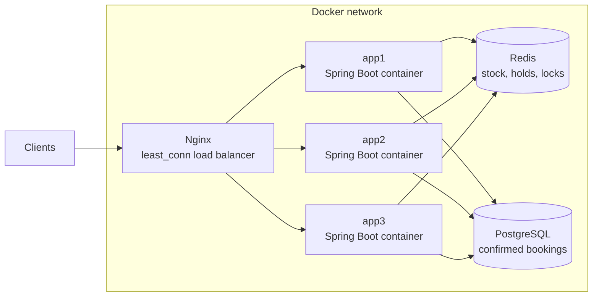
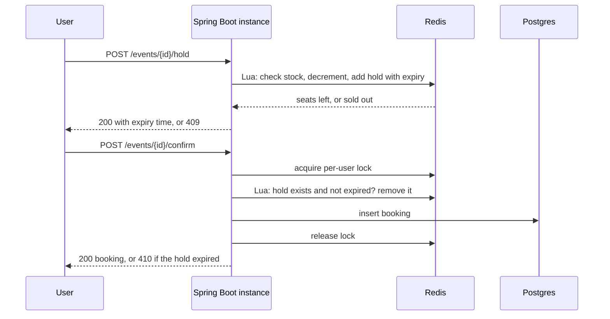

## Architecture



All services run as containers on one Docker network. Only Nginx is reachable
from outside; the app containers publish no ports.

**Design rule: the app instances hold no state.** Everything shared lives in
Redis or Postgres, so any instance can serve any request and more instances
can be added without code changes.

| Component | Responsibility |
|---|---|
| Nginx | Spreads requests across instances (`least_conn`). Retries are disabled, so a booking POST is never silently sent twice. |
| Spring Boot (x3 containers) | Stateless REST API: hold, confirm, stats. Also runs a background reaper that returns expired holds to the pool. |
| Redis | The gate for inventory. Lua scripts make "check stock, decrement, record user" one atomic step. Also holds the TTL holds and the distributed locks. |
| PostgreSQL | System of record for confirmed bookings, with a unique constraint on `(event_id, user_id)`. |

### Request flow



Postgres is only touched on confirm. During a flash sale most users lose the
race or abandon their hold, so those requests never create database load.

### Redis keys (per event)

| Key | Type | Purpose |
|---|---|---|
| `event:{id}:stock` | string | Seats left |
| `event:{id}:users` | set | Users holding or owning a seat (one seat per user) |
| `event:{id}:holds` | sorted set | Holds, scored by expiry time in ms |
| `lock:confirm:{id}:{user}` | string with TTL | Per-user confirm lock |

## How it works

### 1. Atomic stock gate (Redis + Lua)

**Problem.** The obvious version reads the seat counter, checks it, and writes
it back. Under concurrency that is a lost update: many requests read the same
value and overwrite each other. In my first, deliberately naive version,
1,000 users booked a 100-seat event: 1,000 booking rows, and a counter that
only dropped by 16.

**Solution.** One Lua script does everything in a single step: reject if the
user already has a seat, reject if stock is 0, otherwise decrement the stock
and record the user.

**Why it works.** Redis runs a script as one indivisible unit, so no other
request can run between the check and the decrement. All app instances call
the same Redis, so the guarantee holds across instances. `synchronized` or a
Java lock would only protect a single JVM.

### 2. Holds with expiry

**Problem.** Users reserve a seat and then pay. An abandoned reservation must
return its seat, but a Redis key expiring gives no callback, so the stock
counter would never be restored.

**Solution.** Each hold is a member of a sorted set, scored by its expiry
time. A scheduled reaper runs a Lua script that removes every expired hold
and adds the seat back to the stock.

**Details.**
- Expiry is judged with Redis's own clock (`TIME` inside the script), so
  instances with slightly different system clocks never disagree.
- The reaper runs on every instance. A short Redis lock lets only one sweep
  per second, and because the release script is atomic, a seat can never be
  returned twice even if two sweeps overlap.
- A reaper that runs late still works: the expiry times are stored state, not
  events that can be missed.

### 3. Confirming a hold

**Problem.** Confirming involves several steps (check the hold, take payment,
save the booking). A double-click or a client retry could start a second
confirm while the first is still running.

**Solution.**
- A per-user lock (`SET key token NX PX ttl`) rejects the duplicate request
  early.
- Unlock is a Lua script that deletes the key only if the stored token is
  still the caller's, so a slow request can never release someone else's lock.
- A Lua script converts the hold atomically: it fails if the hold is missing
  or expired.
- Confirm is idempotent: if the booking already exists, it is returned
  instead of an error, so a client can safely retry after a lost response.

**Division of labour.** Lua protects inventory. The lock protects side
effects that run before the inventory step, such as a payment call.

### 4. Database safety net

PostgreSQL has a unique constraint on `(event_id, user_id)`. Even if a future
bug let two confirms through, the database refuses the second row. When that
happens the existing booking is returned and the seat is **not** released,
because releasing it would put a seat back into stock that is already sold.

### 5. When something fails halfway

Redis and PostgreSQL are separate systems with no shared transaction. If
Redis grants a seat and the database save then fails, the seat is returned to
the pool explicitly. If the app crashes before it can do that, the hold's
expiry returns the seat automatically.

## Results

### Before and after

Same scenario in both: 1,000 users hit a 100-seat event at the same instant
(all threads released together by a start latch).

| | Naive version (DB read, check, write) | Redis + Lua version |
|---|---|---|
| Successful bookings | 1,000 | 100 |
| "Sold out" responses | 0 | 900 |
| Booking rows in Postgres | 1,000 | 100 |
| Seat counter at the end | 84 (should have been 0) | 0 |
| Oversold | Yes, by 900 | No |

The naive version failed in two ways at once: more bookings than seats, and a
counter that disagreed with the booking table (lost updates).

### Full stack through Nginx

The same flow over real HTTP: 1,000 users try to hold a seat, then the 100
winners confirm. Requests go through Nginx to three separate Spring Boot
instances, so this exercises the cross-instance guarantee.

A clean run:

| Phase | Result |
|---|---|
| Hold | 100 x `200`, 900 x `409` |
| Instance split (hold) | 328 / 343 / 329 across the three instances |
| Confirm | 100 x `200` |
| Final state | 100 bookings in Postgres, Redis stock 0 |

#### First setup: app instances on the host, Nginx in a container

I ran the full-stack test five times in a row:

| Run | Holds granted | Requests with no answer | Final state |
|---|---|---|---|
| 1 | 100 | 0 | 100 bookings, stock 0 |
| 2 | 100 | 0 | 100 bookings, stock 0 |
| 3 | 100 | 38 timeouts | 100 bookings, stock 0 |
| 4 | 100 | 0 | 100 bookings, stock 0 |
| 5 | 100 | 6 timeouts, 40 x `504` | not reached (see below) |

**The invariant held in every run:** exactly 100 seats were granted, and no
run produced more than 100 bookings. In run 5 the test stops at its
"no 5xx" check before the confirm phase, so there is no final-state figure
for that run.

##### Known issue in this setup: connection timeouts

In runs 3 and 5 some requests got no response or a `504`. The Nginx log shows
`upstream timed out while connecting to upstream` for every one of them, so
those requests never reached the application and could not have touched
inventory. That is why the seat guarantee is unaffected.

The likely cause was the setup, not the booking logic. Nginx ran in a Docker
container on Windows, while the three Spring Boot instances ran directly on
the host, so every proxied request crossed Docker Desktop's network layer.
One laptop was also running three JVMs, PostgreSQL, Redis, Nginx and 1,000
test client threads. I did not confirm this cause directly. I moved the app
instances into containers next (below).

Because a timeout leaves the outcome unknown to the client, the test's final
check reads Postgres and Redis directly instead of trusting client-side
counts.

#### After containerizing

After moving the app instances into containers on the same Docker network as
Nginx, I repeated the full-stack test five times:

| Run | Holds granted | Unanswered requests | Confirms | Final state |
|---|---|---|---|---|
| 1 | 100 | 0 | 100 | 100 bookings, stock 0 |
| 2 | 100 | 0 | 100 | 100 bookings, stock 0 |
| 3 | 100 | 0 | 100 | 100 bookings, stock 0 |
| 4 | 100 | 0 | 100 | 100 bookings, stock 0 |
| 5 | 100 | 0 | 100 | 100 bookings, stock 0 |

Each run took 3 to 10 seconds, compared with about 60 seconds for the runs
that had timeouts before. Nginx's access log shows requests reaching all
three containers. In these five runs the test's final "load was spread
across instances" check reported a failure, because every container labelled
its responses `instance-8080` (a bug in how the `X-Served-By` header was
built). After fixing it to read the `INSTANCE_ID` environment variable, the
test passed in full. Five runs is a small sample, so I treat the result as
consistent with the earlier timeouts coming from the Nginx-to-host hop, not
as proof.

## Running it locally

### Prerequisites

- Docker Desktop
- Java 21 and Maven, only if you want to run the tests from your machine

### Start everything

```bash
docker compose up -d --build
```

This builds the app image (multi-stage Dockerfile) and starts PostgreSQL,
Redis, three app containers and Nginx. The apps start in order using
health checks: `app1` waits for PostgreSQL and Redis, and `app2` and `app3`
wait for `app1`, so the three instances never race to create the tables.
Give it about 15 seconds after the command returns.

All client traffic goes to Nginx on **http://localhost:8080**. Every response
carries an `X-Served-By` header (`instance-1`, `instance-2` or `instance-3`),
set from the `INSTANCE_ID` environment variable in `docker-compose.yml`.

Stop everything with `docker compose down`. PostgreSQL data lives in a named
volume and survives this; `docker compose down -v` deletes it too.

### API

| Method | Path | Purpose |
|---|---|---|
| POST | `/api/events` | Create an event, body `{"name": "...", "totalSeats": 100}` |
| POST | `/api/events/{id}/hold?userId=...` | Hold a seat. `200` with the expiry time, `409` if sold out or already held |
| POST | `/api/events/{id}/confirm?userId=...` | Confirm a hold. `200` with the booking, `410` if the hold expired, `409` if a confirm is already in progress |
| GET | `/api/events/{id}/stats` | Redis stock and number of confirmed bookings |
| POST | `/api/events/{id}/book` | The naive version, kept only for the before/after demo |

Holds last 120 seconds (`booking.hold-ttl-seconds` in `application.yml`).

### Tests

```bash
mvn clean test
```

The tests run on your machine and connect to PostgreSQL and Redis through the
ports Docker publishes (5432 and 6379), so `docker compose up -d` must be
running first. `LoadThroughNginxTest` also needs the app containers and Nginx,
so start the full stack with `--build` before running it.

| Test | What it covers | Needs the app containers? |
|---|---|---|
| `NaiveBookingConcurrencyTest` | The naive version. **It is meant to fail**: it demonstrates overselling | No |
| `RedisBookingConcurrencyTest` | 1,000 threads, 100 seats, no overselling | No |
| `HoldExpiryTest` | Holds expire, the reaper returns the seat, confirm before and after expiry | No |
| `LockTest` | Lock ownership and expiry, a double-click confirm creates one booking | No |
| `BookingConstraintTest` | The database rejects a duplicate booking | No |
| `LoadThroughNginxTest` | 1,000 HTTP users through Nginx and three instances | **Yes** |

Run a single test with `mvn test -Dtest=LoadThroughNginxTest`.

## Known limitations

- **Benchmark scope.** Everything, including the 1,000 test clients, runs on
  one laptop, and the test client still reaches Nginx through Docker
  Desktop's port forwarding. Earlier runs with the app on the host showed
  connection timeouts; they did not reappear after containerizing, but five
  runs is a small sample.
- **Stock counter, not seat selection.** Users get "a seat", not seat 14B.
  Per-seat selection would need a different Redis structure.
- **No payment step.** Confirm is where a payment call would go. The confirm
  lock exists to protect that kind of side effect.
- **Single Redis node.** All inventory decisions are serialised by one Redis.
  If it restarts without persistence, in-memory stock and holds are lost, and
  the lock is not safe across a Redis failover. A production setup would add
  persistence or replication, and would use a battle-tested lock library
  (such as Redisson) with automatic lock extension.
- **Lock timeout.** The confirm lock has a fixed 10-second TTL. If the work
  inside it ever ran longer, a second request could enter. The unique
  constraint on bookings is the backstop for that case.
- **Reaper scans all events.** It loads every event from PostgreSQL once a
  second. With many events it should iterate over a Redis set of active
  events instead.
- **Single Nginx.** The load balancer itself is a single point of failure.
- **Schema management.** Tables are created by Hibernate (`ddl-auto: update`).
  A real deployment would use migrations such as Flyway.
- **No authentication.** `userId` is a plain query parameter.
## Demo UI

A small React app (Vite, Tailwind, Framer Motion) to watch the system work:
create an event, hold and confirm a seat with a live countdown, or run a
flash-sale simulation and see seats fill, results arrive and traffic split
across the three instances.

``bash
cd frontend
npm install
npm run dev
``

Open http://localhost:5173. The Docker stack must be running; the dev server
proxies /api to Nginx on port 8080.

The simulator sends requests from the browser, which limits how many run at
once, so it is a fast burst, not 1,000 truly simultaneous requests. The
Java load test is the simultaneous case.
